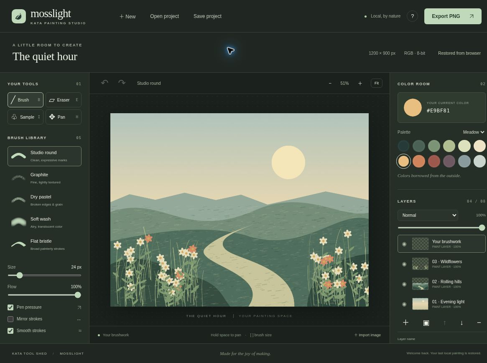
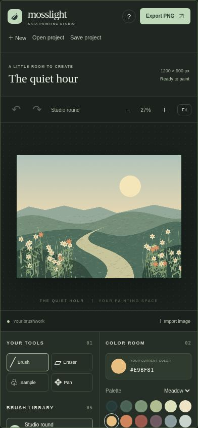

# Kata Mosslight

**A little room to create.** A local-first digital painting studio inspired by Krita's brush-and-layer workflow, with an original quiet botanical identity.

Part of **Kata Tool Shed**. Repository name: `kata-app-inspired-by-krita-codex-dot`.

[Open Mosslight](https://intrepion.github.io/kata-app-inspired-by-krita-codex-dot/) · [Kata Tool Shed](https://intrepion.github.io/tools/)

## Screenshots

Genuine captures of the running localhost app, not mockups.



<details><summary>Narrow-screen layout (390px iframe viewport)</summary>



</details>

## Run locally

Requires Node.js 18 or newer. There are no package dependencies to install.

```sh
npm run dev
```

Open the localhost URL printed by the server (normally `http://127.0.0.1:4173`). Do not open `index.html` as a `file://` URL. `PORT=4300 npm run dev` selects another port. On PowerShell use `$env:PORT=4300; npm run dev`.

```sh
npm run check   # JavaScript syntax checks and 17 Node tests
npm run build   # Static output in dist/
```

Serve `dist/` with an HTTP server for deployment. The source dev server also exposes `tests/browser.html`, a browser-native Canvas engine test suite. It is deliberately excluded from the production build.

## Make something

1. Begin with **The quiet hour**, a four-layer original landscape study, or choose **New → Blank canvas**.
2. Pick one of five continuous brushes: Studio round, Graphite, Dry pastel, Soft wash, or Flat bristle.
3. Choose a palette color or any six-digit hex color. Adjust brush size and flow. Optional pressure input changes diameter for supported pens. Mirror and smoothing can be toggled independently.
4. Paint on the selected layer. Add, rename, duplicate, reorder, hide, clear, or remove layers. Set opacity or choose normal, multiply, or screen blending.
5. **Save project** downloads an editable `.mosslight` JSON file with embedded PNG layers. **Open project** restores it. **Export PNG** flattens only visible layers, preserving transparency.

Images can be imported as centered, scaled-down raster layers. Accepted types are PNG, JPEG, and WebP, up to 12 MB / 24 megapixels. They stay in the browser.

## Keyboard and accessibility

- **B / E / I / H:** brush, eraser, color sampler, pan.
- **[ / ]:** decrease / increase brush size.
- **Ctrl/⌘ Z**, **Ctrl/⌘ Shift Z**, or **Ctrl/⌘ Y:** undo / redo.
- **Ctrl/⌘ S:** download an editable project.
- **Space + drag:** pan; **F:** fit the canvas.
- Focus the painting canvas, then use arrow keys to move a keyboard brush cursor. Shift + arrows moves farther. Tap Space to place a brush mark.
- Controls have labels, focus indicators, semantic buttons, selected/pressed states, and live status announcements. The canvas itself is a visual task; keyboard stamping is supported, not a full nonvisual painting experience.
- On narrow screens the canvas moves above the two tool panels. There are no hidden desktop-only features.

## What is real, and what is intentionally small

This is a functional small raster editor, not a Krita replacement. It has five original procedural brush behaviors, 8 layers, a fixed 1200 × 900 canvas, and 20 document-level undo steps. Mouse, touch, and supported pen events are accepted. The brush flow is applied per dab, so overlapping dabs build up color.

It does **not** support Krita `.kra`, PSD, OpenRaster, animation, masks, vector layers, selection/transform tools, ICC/CMYK workflows, infinite canvases, advanced perspective assistants, or physical pigment simulation. Pen pressure requires compatible hardware and browser input support and has not been verified on physical pen hardware. Image imports are centered and fit inside the document; there is no subsequent transform UI.

## Local persistence and privacy

There is no backend, account, telemetry, remote asset request, or upload. Autosave uses this origin's browser local storage after edits. Browser limits, private mode, storage cleanup, another app on the same origin, or a new hostname can affect persistence. Autosave is best-effort and reports failure. **Download project files for durable backups.** Browser autosave is a single latest painting, not a document library.

Starting a new painting, loading the starter, or opening a project warns before replacing work that has not been downloaded. Destructive layer changes remain undoable. Undo history is in-memory and does not survive reload. Project imports validate format, dimensions, layer count/settings, PNG references, and a 24 MB file-size limit. Incoming layer labels are rendered as text, not HTML.

## Project structure

- `src/model.js`: validation, history, presets, and pure geometry helpers.
- `src/engine.js`: Canvas 2D painting, compositing, and raster serialization.
- `src/study.js`: original layered landscape artwork.
- `src/app.js`: UI, input, layers, local storage, and file operations.
- `docs/INSPIRATION.md`: primary-source research and scope decisions.
- `docs/QA.md`: actual verification results and limits.
- `app.json`: Tool Shed metadata and canonical project links.

## License and attribution

MIT, see [LICENSE](LICENSE). Original code and assets. Inspired by [Krita](https://krita.org/en/), with no affiliation, endorsement, borrowed artwork, or file-format compatibility. The combined `.gitignore` covers Windows, macOS, Linux/Unix, editor files, build outputs, dependencies, local secrets, and test artifacts.

## Deployment

GitHub Actions runs the test suite and static build on each push to `main`, then deploys only `dist/` to GitHub Pages. Source, documentation and genuine screenshots live in this repository.
